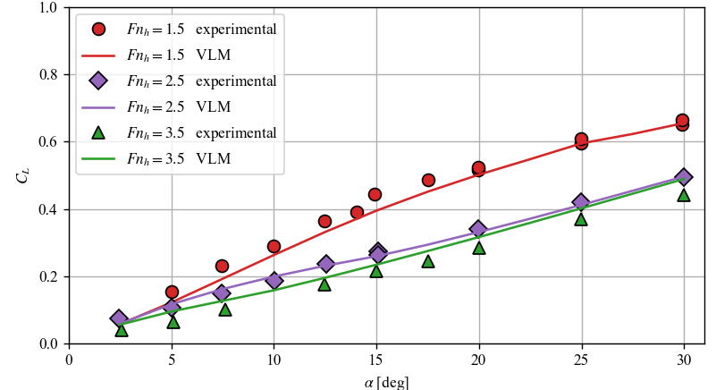
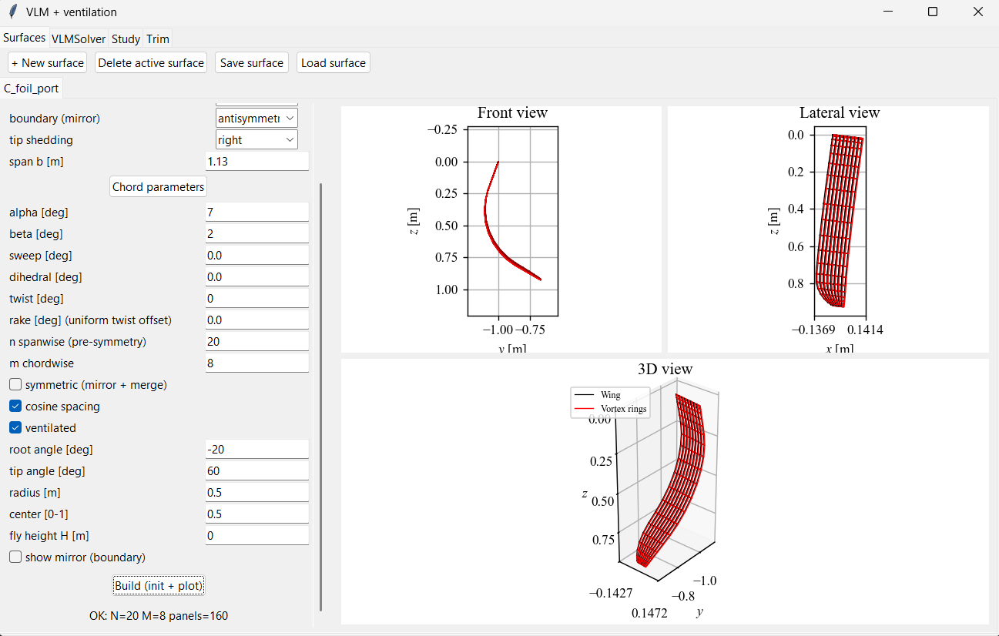
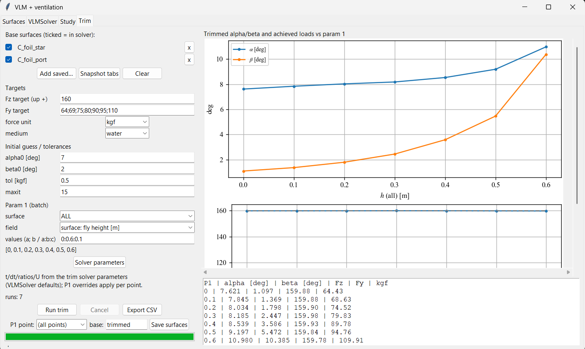

# Unsteady VLM with Ventilation Coupling for Surface-Piercing Foils


A hydrodynamic simulation pipeline built from scratch, coupling a Vortex-Lattice Method (VLM) with an analytic ventilation model. Designed for surface-piercing hydrofoils, this tool predicts ventilation-induced lift loss and features a trimming algorithm to find optimal operating points based on target loadings.

## Key Features

* **Advanced VLM Engine (`src/VLMSolver.py`):** Features wake shedding, convection, and rollup. Biot–Savart induction is optimized and accelerated using Numba. Includes free-surface boundary conditions (symmetric/antisymmetric mirroring).
* **Analytic Ventilation Coupling:** Fully analytic cavity model that locally corrects the lift slope section-by-section without requiring external data files.
* **Foil Trimming & Optimization:** Dynamic adjustment of flying height (emerged part cut from mesh) and automated pitch/yaw trimming to converge on specific operating points. *Target loading values for the trimming algorithm are derived from Tom Speer's hydrofoil research.*
* **Rapid UI Prototyping:** A fully functional Tkinter GUI built via agentic AI workflow orchestration, demonstrating the integration of complex backend physics solvers into accessible end-user applications.

---

## Experimental Validation

The physical accuracy of the ventilation model has been benchmarked against experimental data from *Harwood, C. M., Young, Y. L., & Ceccio, S. L. (JFM, 2016)*. 

<p align="center">
  
</p>
<p align="center"><em>Comparison between experimental data and the VLM + ventilation model predictions for a vertical strut in a ventilated flow. The strut is rectangular with an immersed aspect ratio of 1.</em></p>

---

## Interactive GUI

The project includes a standalone interface to build surfaces, run the solver, sweep parameters, and trim foils in real-time. This tool is useful for efficiently studying the influence of parameters. The showed foils are include in `data/`.

<p align="center">
  
</p>
<p align="center"><em>Main interface for geometry definition and visualization.</em></p>

<p align="center">
  
</p>
<p align="center"><em>Trimming module converging towards Tom Speer's target loading values.</em></p>

---

## Quickstart & Reproducibility

> **💡 Note for quick viewing:** You don't need to install or run anything to see the results! Simply click on **[`quickstart.ipynb`](quickstart.ipynb)** to view the pre-calculated validation plots and core algorithmic logic directly in your browser.

For those who want to run the code locally or launch the interactive GUI:

```bash
# 1. Clone the repository
git clone [https://github.com/your-username/your-repo-name.git](https://github.com/your-username/your-repo-name.git)
cd your-repo-name

# 2. Install dependencies
pip install -r requirements.txt

# 3. Run the interactive GUI
python gui_vlm.py
```
---

## Usage as a Library

The core physics engine is completely decoupled from the GUI. You can easily import the VLM solver as a standalone Python library to use in your own scripts, parametric studies, or optimization loops.


